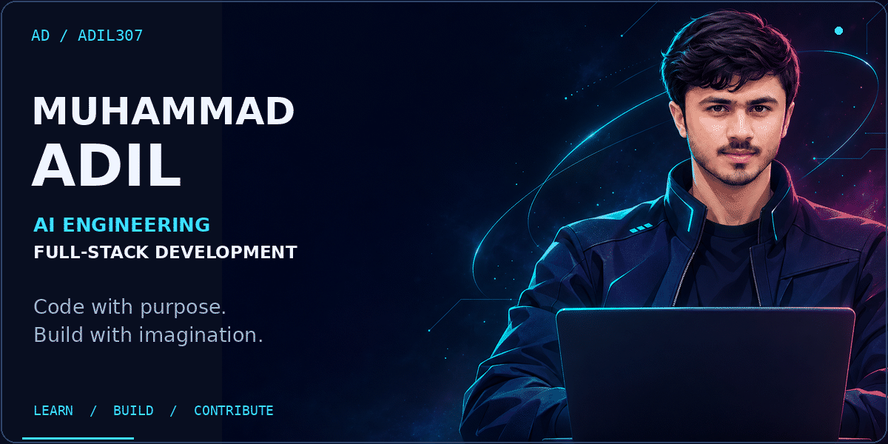
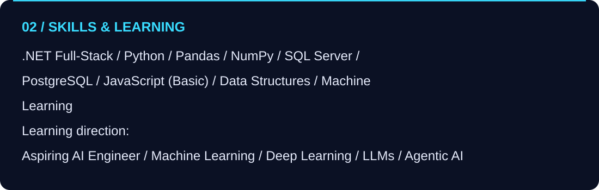
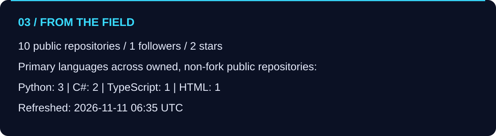

# Muhammad Adil
**.NET Full-Stack Developer · Python & Data · Aspiring AI Engineer**

[Explore my repositories](https://github.com/Adil307?tab=repositories)

### Building practical software. Learning intelligent systems.
Founder of **[AxiomBraid](https://github.com/Adil307/AxiomBraid)** and **ROHI**.  
Founder & Chairman of **GLCS** and **Smile of Tomorrow**.

*Updated 2026-11-07 17:45 UTC. Stars exclude forks. Language counts describe repositories, not proficiency.*

### Recently updated public projects
| Project | Description | Language | Stars |
| --- | --- | --- | ---: |
| [BGP](https://github.com/Adil307/BGP) | Explore the source on GitHub. | C# | 0 |
| [HeatShield-AI](https://github.com/Adil307/HeatShield-AI) | Explore the source on GitHub. | Python | 0 |
| [AxiomBraid](https://github.com/Adil307/AxiomBraid) | An explainable, safety-first Python framework for data quality, validation, cleaning, and drift detection. | Python | 2 |
| [Nexus](https://github.com/Adil307/Nexus) | Explore the source on GitHub. | TypeScript | 0 |
| [CodeAlpha-Task](https://github.com/Adil307/CodeAlpha-Task) | Explore the source on GitHub. | Python | 0 |

---
**Automatic refresh:** every 6 hours (GitHub scheduling may be delayed), on changes to the updater, or manually from Actions. Only public GitHub data is fetched. Skills and learning goals are explicitly maintained in `.github/workflows/refresh-profile.yml`; they are never inferred as expertise from code.
