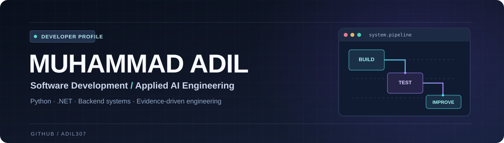
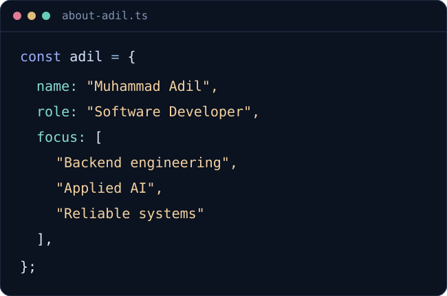

  

   

  **Software Developer · Python & .NET · Applied AI Engineering**

  
  

 

## 01 / About Me

<table><tr>
<td width="55%" valign="top">
  
</td>
<td width="45%" valign="top">
  
</td>
</tr></table>

I’m **Muhammad Adil**, a software developer working on .NET applications, Python tools, backend systems and applied AI. I prefer reliable implementations over exaggerated demos: **define a problem, establish a baseline, test edge cases, measure results, and document limitations.**

I’m also the founder of **AxiomBraid** and **ROHI**, and the Founder & Chairman of **Global Learning Community for Students (GLCS)** and **Smile of Tomorrow**.

## 02 / Connect

  
  
  

## 03 / Tech Stack

  

**Current learning direction:** LLMs, retrieval-augmented generation, tool calling, agent workflows, and production AI systems. These are areas of active study, not a claim of mastery.

## 04 / Featured Engineering Projects

<table><tr>
<td width="50%" valign="top">

### [AxiomBraid](https://github.com/Adil307/AxiomBraid)

An explainable, safety-first Python framework for dataset inspection, data-quality scoring, controlled cleaning, schema validation and drift detection.

`Python` · `Data quality` · `Testing`

</td><td width="50%" valign="top">

### [Intelligent API Rate Limiter](https://github.com/Adil307/Intelligent-API-Rate-Limiter)

A sliding-window rate limiter, progressed from local state to Redis-backed coordination across two FastAPI instances, with documented concurrency and failure tests.

`Python` · `FastAPI` · `Redis`

</td></tr><tr><td width="50%" valign="top">

### [HeatShield AI](https://github.com/Adil307/HeatShield-AI)

Evidence-grounded urban-heat decision support with traceable prioritization, controlled recommendations and a locally grounded assistant.

`Python` · `Applied AI` · `Evidence`

</td><td width="50%" valign="top">

### [BGP Operations System](https://github.com/Adil307/BGP)

A .NET business application for project and contractor operations, inventory requests, stock management and granular permissions.

`C#` · `ASP.NET Core MVC` · `SQL Server`

</td></tr></table>

<b>An experiment I learned from</b>

A rate-limiter policy of **100 requests per user per rolling 60 seconds** passed locally, but two separate in-memory instances allowed **120 of 120** requests through. Switching to an atomic Redis-backed shared state accepted **100** and rejected **20** in the corresponding sequential test. These are documented local prototype results, not production benchmarks.

[Read the reproducible tests and limitations](https://github.com/Adil307/Intelligent-API-Rate-Limiter)

## 05 / GitHub Analytics

  
  <table><tr>
    <td width="50%"></td>
    <td width="50%"></td>
  </tr></table>

Generated using public GitHub API data approximately every six hours. Language counts refer to repositories' primary language, **not** individual skill level. The update timeline is based on public repository last-push timestamps, **not** the GitHub contribution calendar. Stars exclude forks.

## 06 / Engineering Highlights

  
  
  

These are **project highlights**, not automatically awarded GitHub trophies. I’d rather show work with testable evidence than decorative rankings.

---

**Build deliberately. Measure carefully. Improve continuously.**

[Explore all public repositories](https://github.com/Adil307?tab=repositories)

