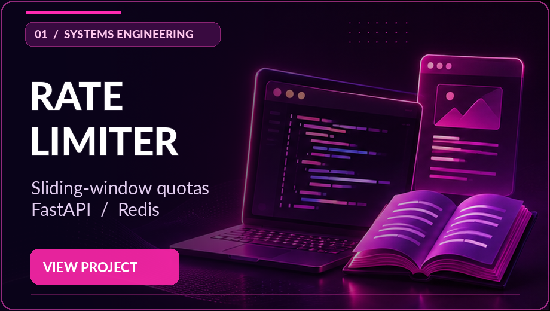
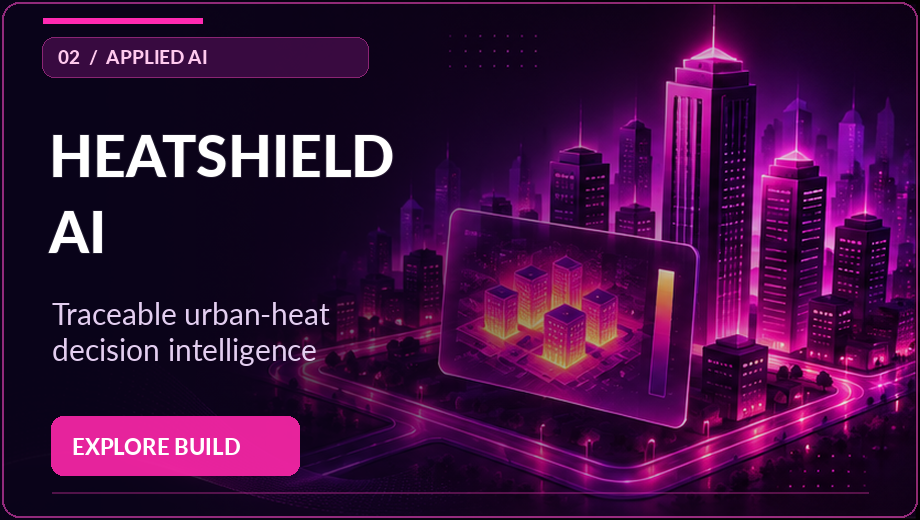
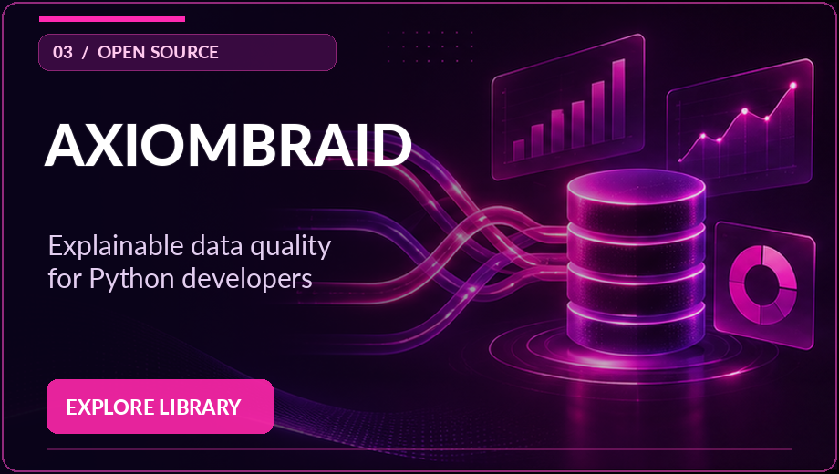
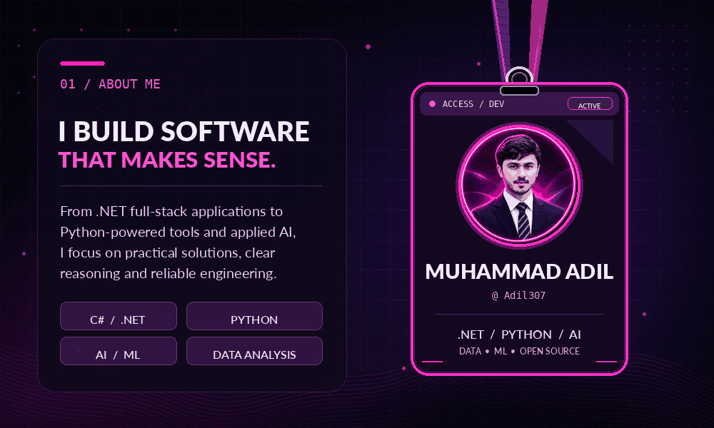
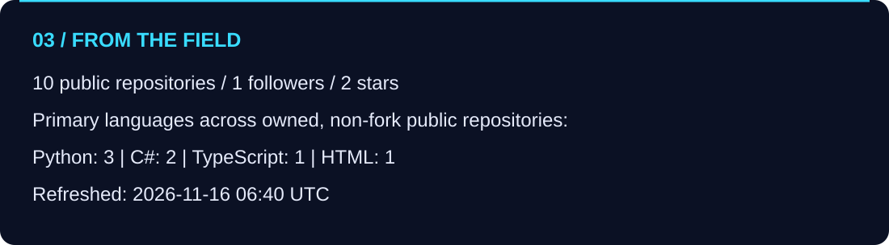
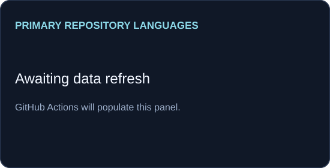
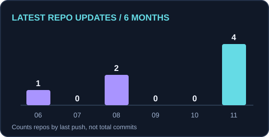
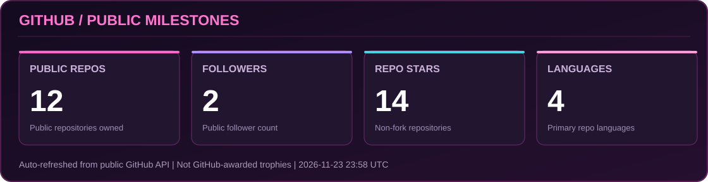
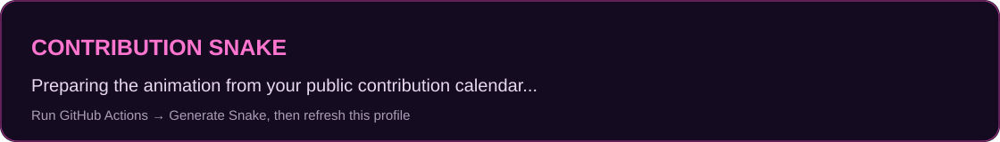

  
  
  
  

   
   

  

   
  <strong>Software Developer · Python &amp; .NET · Applied AI Engineering</strong>

  

 

<!-- ADIL307_FEATURE_GRID_START -->

  SELECTED WORK &nbsp; / &nbsp; BUILDING IN PUBLIC

  
  

  
  

<!-- ADIL307_FEATURE_GRID_END -->

## 01 / About Me

  

I work across **.NET full-stack development, Python, applied AI, data analysis and machine learning**. I build practical software, research tools and open-source projects with an emphasis on reliability, clear reasoning and measurable results.

## 02 / Connect

  
  
  

<!-- OPTIONAL: Replace these placeholders with YOUR REAL public URLs before enabling.

-->

## 03 / Tech Stack

  

 

  
  
  
  
  
  
  
  

**Current learning direction:** LLMs, retrieval-augmented generation, tool calling, agent workflows, and production AI systems. These are areas of active study, not a claim of mastery.

## 04 / Featured Engineering Projects

<table><tr>
<td width="50%" valign="top">

### [AxiomBraid](https://github.com/Adil307/AxiomBraid)

An explainable, safety-first Python framework for dataset inspection, data-quality scoring, controlled cleaning, schema validation and drift detection.

`Python` · `Data quality` · `Testing`

</td><td width="50%" valign="top">

### [Intelligent API Rate Limiter](https://github.com/Adil307/Intelligent-API-Rate-Limiter)

A sliding-window rate limiter, progressed from local state to Redis-backed coordination across two FastAPI instances, with documented concurrency and failure tests.

`Python` · `FastAPI` · `Redis`

</td></tr><tr><td width="50%" valign="top">

### [HeatShield AI](https://github.com/Adil307/HeatShield-AI)

Evidence-grounded urban-heat decision support with traceable prioritization, controlled recommendations and a locally grounded assistant.

`Python` · `Applied AI` · `Evidence`

</td><td width="50%" valign="top">

### [BGP Operations System](https://github.com/Adil307/BGP)

A .NET business application for project and contractor operations, inventory requests, stock management and granular permissions.

`C#` · `ASP.NET Core MVC` · `SQL Server`

</td></tr></table>

<b>An experiment I learned from</b>

A rate-limiter policy of **100 requests per user per rolling 60 seconds** passed locally, but two separate in-memory instances allowed **120 of 120** requests through. Switching to an atomic Redis-backed shared state accepted **100** and rejected **20** in the corresponding sequential test. These are documented local prototype results, not production benchmarks.

[Read the reproducible tests and limitations](https://github.com/Adil307/Intelligent-API-Rate-Limiter)

## 05 / GitHub Analytics

### Self-generated live profile charts

  
  <table><tr>
    <td width="50%"></td>
    <td width="50%"></td>
  </tr></table>

Self-generated charts update from public GitHub API data approximately every six hours. Language charts count primary repository languages, not proficiency. The self-generated update timeline tracks last-push timestamps, not the contribution calendar.

### Live GitHub stats and contribution charts

  
  

  
  

  
  

  
  

  

Third-party cards may be cached, rate-limited, or temporarily unavailable; their figures may differ because providers use different definitions and data scopes. Self-generated charts above remain the primary fallback.

## 06 / GitHub Milestones

  

Metrics from the public GitHub API, refreshed about every six hours. These are **not official GitHub trophies**. This avoids an unreliable external trophy image provider.

## 07 / Contribution Snake

  

The local SVG starts with a readable placeholder. After the first successful **Generate Snake** workflow run, it becomes an animated contribution snake, refreshed every 12 hours.

## 08 / Engineering Highlights

  
  
  

These badges are **engineering project highlights** rather than GitHub-awarded trophies. The GitHub Trophies section above is generated independently by a third-party service.

---

**Build deliberately. Measure carefully. Improve continuously.**

[Explore all public repositories](https://github.com/Adil307?tab=repositories)

