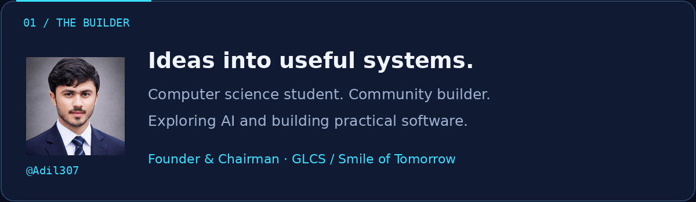
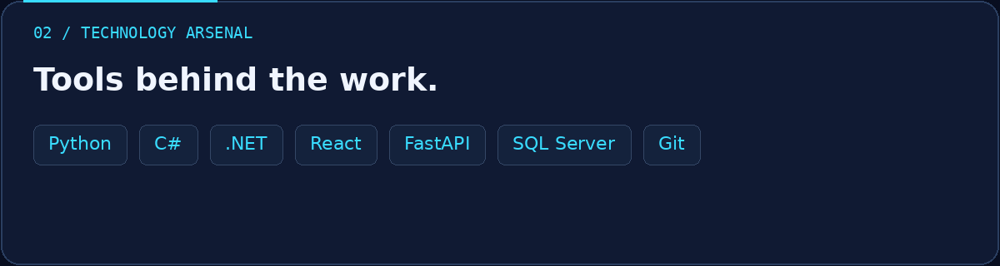
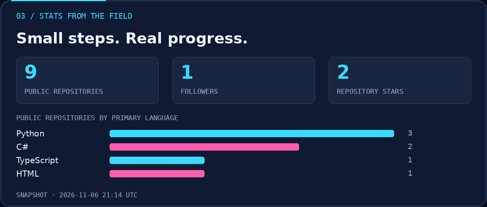
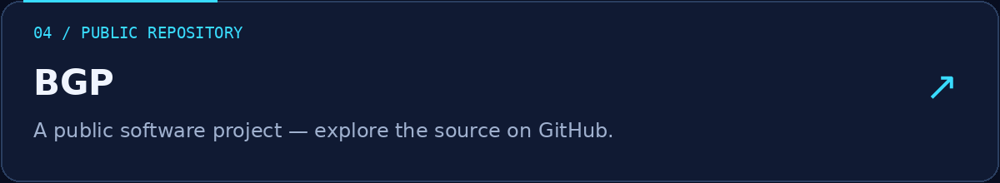
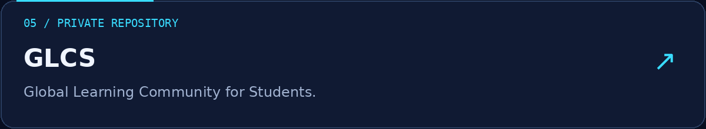
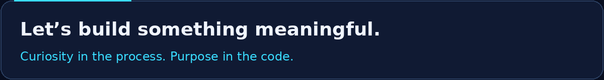

# Muhammad Adil

**AI Engineering · Full\-Stack Development · Community Building**

[Explore repositories](https://github.com/Adil307?tab=repositories) · [Static header](assets/hero.png)

**Muhammad Adil** — Computer science student\. Community builder\. Exploring AI and building practical software\.  
Founder & Chairman · GLCS / Smile of Tomorrow.

**Tools:** Python · C\# · \.NET · React · FastAPI · SQL Server · Git.

Public repositories: **9** · Followers: **1** · Repository stars: **2**.  
Snapshot: 2026-11-06 21:14 UTC. These are public API values, not live counters. Language bars count repositories by primary language; they are not skill ratings.

### Featured projects

**BGP:** A public software project — explore the source on GitHub\. 

**GLCS:** Global Learning Community for Students\. Repository access is restricted to authorized collaborators\.

